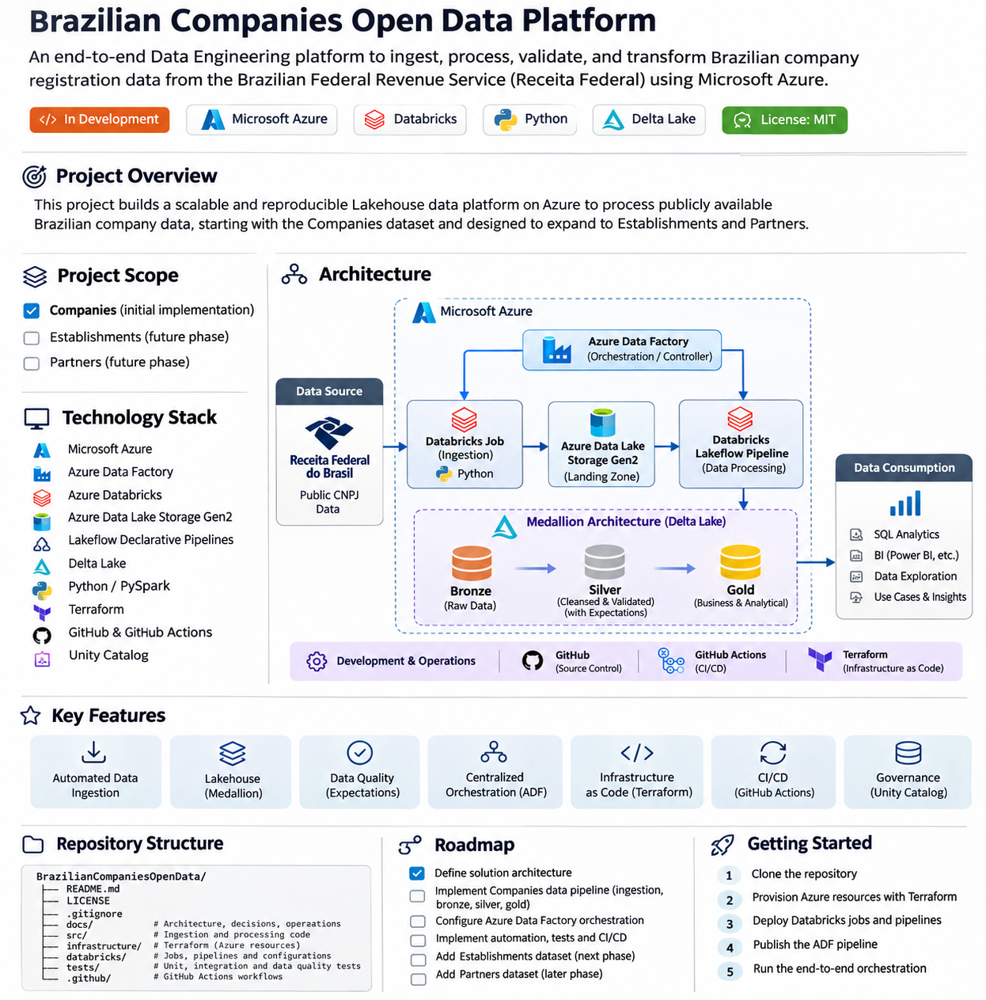

# Brazilian Companies Open Data Platform

[](https://github.com/YOUR-USERNAME/BrazilianCompaniesOpenData)
[](https://www.python.org/)
[](https://azure.microsoft.com/)
[](https://www.databricks.com/)
[](https://www.terraform.io/)
[](LICENSE)

An end-to-end Data Engineering platform designed to ingest, process, validate, and transform Brazilian company registration data published by the Brazilian Federal Revenue Service (Receita Federal do Brasil).

Built with Microsoft Azure, Azure Data Factory, Azure Databricks, Azure Data Lake Storage Gen2, Python, PySpark, and Delta Lake, this project demonstrates modern Data Engineering practices through a scalable and reproducible Lakehouse architecture.

---

## Table of Contents

- [Project Overview](#project-overview)
- [Business Context](#business-context)
- [Project Scope](#project-scope)
- [Architecture](#architecture)
- [Technology Stack](#technology-stack)
- [Data Sources](#data-sources)
- [Data Engineering Workflow](#data-engineering-workflow)
- [Medallion Architecture](#medallion-architecture)
- [Data Quality](#data-quality)
- [Orchestration](#orchestration)
- [Infrastructure as Code](#infrastructure-as-code)
- [CI/CD](#cicd)
- [Repository Structure](#repository-structure)
- [Getting Started](#getting-started)
- [Cost Considerations](#cost-considerations)
- [Roadmap](#roadmap)
- [License](#license)

---

## Project Overview

The main goal of this project is to build a complete Data Engineering platform using publicly available Brazilian company registration data.

The solution implements automated data ingestion, distributed data processing, data quality validation, centralized orchestration, and infrastructure automation.

The project aims to demonstrate the implementation of the following Data Engineering concepts and practices:

- Automated data ingestion and file management.
- Cloud-based data lake architecture.
- Medallion Architecture (Bronze, Silver, and Gold).
- Distributed data processing with Apache Spark.
- Declarative data pipelines using Databricks Lakeflow.
- Data quality enforcement and monitoring.
- Centralized workflow orchestration.
- Infrastructure as Code (IaC).
- Continuous Integration and Continuous Deployment (CI/CD).
- Reproducible cloud infrastructure and data workflows.

The repository is designed to be reusable, allowing other engineers to deploy and reproduce the solution using their own Azure subscriptions.

## Business Context

The Brazilian Federal Revenue Service provides public datasets containing information about companies registered in Brazil.

These datasets contain valuable information that can be used to build analytical solutions and generate insights about the Brazilian business ecosystem.

This project uses these public datasets to demonstrate how large-scale data platforms can be designed and implemented using modern cloud technologies.

Potential analytical use cases include:

- Company distribution by state and municipality.
- Company registration and opening trends.
- Company distribution by economic activity (CNAE).
- Active versus inactive companies.
- Company size distribution.
- Analysis of the Brazilian business ecosystem.

## Project Scope

The project will be developed incrementally, starting with the Companies dataset.

The architecture is designed to support additional data domains in future development phases.

| Data Domain | Implementation Phase | Status |
|---|---|---|
| Companies | Phase 1 | Planned |
| Establishments | Phase 2 | Planned |
| Partners | Phase 3 | Planned |
| Reference datasets | Future expansion | Planned |

The initial implementation will focus on establishing the ingestion framework, Lakehouse architecture, data quality standards, and orchestration strategy using the Companies dataset.

Once the initial pipeline is stable, additional data domains will be incorporated using the same architectural principles.

## Architecture

The platform follows a Lakehouse architecture based on the Medallion Architecture pattern.

Azure Data Factory acts as the central orchestration layer, coordinating the execution of Databricks ingestion and processing jobs.

### High-Level Architecture



*Figure 1 — High-level solution architecture.*

### Architecture Components

| Component | Responsibility |
|---|---|
| Azure Data Factory | Centralized workflow orchestration and execution control |
| Azure Databricks | Distributed data processing |
| Python | Data extraction and ingestion |
| Azure Data Lake Storage Gen2 | Raw data storage and landing zone |
| Lakeflow Declarative Pipelines | Declarative data transformation and pipeline management |
| Delta Lake | Reliable transactional data storage |
| Terraform | Infrastructure provisioning |
| GitHub Actions | CI/CD automation |
| Unity Catalog | Data governance and catalog management |

### Architecture Principles

The solution follows these architectural principles:

- **Separation of concerns:** ingestion, processing, and orchestration have clearly defined responsibilities.
- **Scalability:** distributed processing using Apache Spark.
- **Reusability:** modular code and reusable infrastructure definitions.
- **Reliability:** execution tracking, error handling, and data quality validation.
- **Reproducibility:** infrastructure and application artifacts are version-controlled.
- **Maintainability:** standardized project structure and technical documentation.

## Technology Stack

| Category | Technology |
|---|---|
| Cloud Platform | Microsoft Azure |
| Orchestration | Azure Data Factory |
| Data Storage | Azure Data Lake Storage Gen2 |
| Data Processing | Azure Databricks |
| Processing Framework | Apache Spark / PySpark |
| Pipeline Framework | Lakeflow Declarative Pipelines |
| Storage Format | Delta Lake |
| Programming Language | Python |
| Query Language | SQL |
| Infrastructure as Code | Terraform |
| Version Control | Git / GitHub |
| CI/CD | GitHub Actions |
| Data Governance | Unity Catalog |

## Data Sources

The project uses publicly available datasets from the Brazilian Federal Revenue Service.

**Official data source:**

[Receita Federal — Public CNPJ Data](https://www.gov.br/receitafederal/pt-br/assuntos/orientacao-tributaria/cadastros/cadastro-nacional-de-pessoas-juridicas-cnpj/dados-publicos-cnpj)

### Initial Dataset

| Dataset | Description |
|---|---|
| Companies | Brazilian company registration information |

### Future Datasets

| Dataset | Description |
|---|---|
| Establishments | Company establishment information |
| Partners | Company ownership and partner information |
| CNAEs | Economic activity classifications |
| Municipalities | Brazilian municipality reference data |

Source files are downloaded directly from the official data provider and are not stored in this GitHub repository.

## Data Engineering Workflow

The solution is divided into two main Databricks jobs, orchestrated by Azure Data Factory.

### 1. Data Ingestion

A Python-based Databricks Job is responsible for collecting and storing source files.

Its main responsibilities include:

- Retrieving source files from the official data provider.
- Downloading compressed datasets.
- Validating downloaded files.
- Calculating file checksums.
- Uploading source files to Azure Data Lake Storage Gen2.
- Recording ingestion metadata and execution status.

The original files are preserved in the ADLS landing zone to support traceability and reprocessing.

### 2. Data Processing

A Databricks Lakeflow Declarative Pipeline processes the ingested datasets.

The initial implementation focuses on the Companies domain.

Its responsibilities include:

- Reading source files from the ADLS landing zone.
- Creating Bronze Delta tables.
- Applying data cleansing and standardization.
- Enforcing data quality expectations.
- Creating Silver Delta tables.
- Applying business transformations.
- Creating Gold analytical tables.

## Medallion Architecture

The platform uses three logical data layers.

### Bronze Layer

Stores ingested source data in Delta format.

Main characteristics:

- Preserve source information.
- Maintain ingestion metadata.
- Track source files.
- Support data traceability.
- Enable data reprocessing.

### Silver Layer

Stores cleansed, standardized, and validated datasets.

Main characteristics:

- Data type standardization.
- Null value handling.
- Duplicate identification.
- Business rule validation.
- Data quality expectations.
- Invalid record handling.

### Gold Layer

Stores curated datasets designed for analytical consumption.

Potential data models include:

- Company dimension.
- Company registration status.
- Company size classification.
- Economic activity analysis.
- Geographic company distribution.

## Data Quality

Data quality is implemented primarily in the Silver layer using Lakeflow Declarative Pipelines expectations.

Initial validation rules may include:

- Mandatory field validation.
- Valid company identifiers.
- Valid date formats.
- Business rule validation.
- Duplicate record detection.

Data quality expectations will be configured according to the severity of each validation rule.

The solution will also support monitoring of data quality violations and the investigation of rejected records.

## Orchestration

Azure Data Factory acts as the central controller of the platform.

The main orchestration workflow follows these steps:

1. Start pipeline execution.
2. Generate an execution identifier.
3. Trigger the Databricks ingestion job.
4. Wait for ingestion completion.
5. Validate ingestion results.
6. Trigger the Databricks processing pipeline.
7. Monitor processing execution.
8. Record execution status.
9. Handle failures and notifications.

The orchestration layer is responsible for execution dependencies, retries, timeouts, and operational monitoring.

Business transformations and data processing logic remain within Azure Databricks.

## Infrastructure as Code

Terraform is used to provision and manage the Azure infrastructure.

The infrastructure definition is designed to support reproducible deployments across different environments.

Planned infrastructure components include:

- Azure Resource Group.
- Azure Storage Account.
- Azure Data Lake Storage Gen2.
- Azure Data Factory.
- Azure Databricks Workspace.
- Required access permissions and integrations.

## CI/CD

GitHub Actions is used to automate validation and deployment workflows.

The CI/CD implementation is designed to include:

- Python code quality checks.
- Automated unit tests.
- Configuration validation.
- Infrastructure validation.
- Databricks resource deployment.
- Automated deployment workflows.

Environment-specific configurations and credentials must be managed securely and must never be committed to the repository.

## Repository Structure

The repository is organized to separate ingestion, processing, infrastructure, testing, and documentation.

```text
BrazilianCompaniesOpenData/
│
├── README.md
├── LICENSE
├── .gitattributes
│
├── docs/
│   ├── images/
│   │   └── architecture.png
│   ├── architecture/
│   ├── decisions/
│   ├── data-governance/
│   └── operations/
│
├── src/
│   ├── ingestion/
│   ├── pipelines/
│   │   ├── bronze/
│   │   ├── silver/
│   │   └── gold/
│   └── common/
│
├── infrastructure/
│   └── terraform/
│
├── databricks/
│   ├── jobs/
│   ├── pipelines/
│   └── databricks.yml
│
├── tests/
│   ├── unit/
│   ├── integration/
│   └── data_quality/
│
└── .github/
    └── workflows/
```

## Getting Started

This project is designed to be reproducible by other engineers using their own Azure subscriptions and Databricks environments.

### Prerequisites

Before deploying the solution, the following tools and resources will be required:

- An active Microsoft Azure subscription.
- Azure Databricks workspace.
- Azure Data Factory.
- Azure CLI.
- Terraform.
- Python 3.11 or compatible version.
- Databricks CLI.
- Git.

### Deployment

Detailed deployment instructions will be provided as the infrastructure and application components are implemented.

The intended deployment workflow is:

1. Clone the repository.
2. Configure Azure authentication.
3. Configure environment-specific variables.
4. Provision Azure resources using Terraform.
5. Deploy Databricks resources.
6. Publish Azure Data Factory pipelines.
7. Execute the main orchestration pipeline.

### Clone the Repository

```bash
git clone https://github.com/YOUR-USERNAME/BrazilianCompaniesOpenData.git

cd BrazilianCompaniesOpenData
```

Replace `YOUR-USERNAME` with your GitHub username.

## Cost Considerations

Running this project requires Azure resources that may generate cloud infrastructure and processing costs.

Users are responsible for their own Azure subscriptions and resource consumption.

Before deploying the solution:

- Review the pricing of each Azure service.
- Use appropriately sized compute resources.
- Avoid leaving unnecessary compute resources running.
- Monitor storage and processing consumption.
- Remove unused infrastructure when the project is no longer needed.

The project does not include shared cloud infrastructure. Each user must provision and manage their own environment.

## Roadmap

The project is being developed incrementally.

### Phase 1 — Initial Implementation

- [ ] Define the solution architecture.
- [ ] Implement the Companies ingestion module.
- [ ] Provision Azure infrastructure using Terraform.
- [ ] Configure Azure Data Lake Storage Gen2.
- [ ] Implement the Databricks ingestion job.
- [ ] Implement the Bronze processing layer.
- [ ] Implement the Silver processing layer and expectations.
- [ ] Implement the Gold processing layer.
- [ ] Configure Azure Data Factory orchestration.

### Phase 2 — Engineering Practices

- [ ] Implement automated unit tests.
- [ ] Implement integration tests.
- [ ] Implement GitHub Actions CI/CD.
- [ ] Implement monitoring and observability.
- [ ] Implement execution auditing.
- [ ] Document the deployment process.

### Phase 3 — Data Domain Expansion

- [ ] Add the Establishments dataset.
- [ ] Implement Establishments Bronze, Silver, and Gold layers.
- [ ] Add the Partners dataset.
- [ ] Implement Partners Bronze, Silver, and Gold layers.
- [ ] Add reference datasets such as CNAEs and Municipalities.
- [ ] Expand analytical data models.

## Contributing

Contributions, suggestions, and improvements are welcome.

If you would like to contribute:

1. Fork the repository.
2. Create a feature branch.
3. Implement your changes.
4. Add or update automated tests.
5. Submit a Pull Request describing your changes.

More detailed contribution guidelines may be added as the project evolves.

## License

This project is licensed under the MIT License.

See the [LICENSE](LICENSE) file for details.

## Disclaimer

This is an independent educational and portfolio project.

It is not affiliated with, endorsed by, or maintained by the Brazilian Federal Revenue Service or Microsoft.